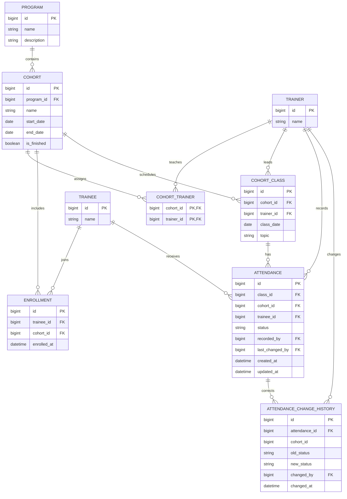

# Design - iSpark Classroom Attendance

## Architecture and domain model

The app uses **Angular** for the separate, component-based frontend; **FastAPI**
for request validation and interactive OpenAPI documentation; and
**PostgreSQL with psycopg 3** for persistence. SQL is written by hand; there is
no ORM. The API reads `DATABASE_URL` from environment configuration.

Programs own cohorts. Trainers are assigned to cohorts through a join table.
Trainees are global people, enrolled in cohorts through `enrollments`, so a
person can attend multiple cohorts without duplicate trainee records. Each
class belongs to one cohort and is led by one assigned trainer. Attendance is
scoped to a class and cohort, and stores the trainee, status, recording
trainer, last-changing trainer, and timestamps. Status corrections are also
recorded in an append-only change-history table. Attendance rates are derived
from saved attendance; they are not stored independently. A cohort's
`is_finished` flag archives it without deleting its records.

## Business-rule enforcement

| Rule | Enforcement |
| --- | --- |
| Cohort isolation and separate histories | Roster, class, report, and history queries scope records to the selected cohort. Composite foreign keys keep attendance's class, enrollment, and trainer relationships in that same cohort. |
| Attendance requires enrollment; trainers must be assigned | Database composite foreign keys enforce both when attendance is saved. A class also references its cohort/trainer assignment. |
| One attendance per trainee per class; fixed statuses | A unique constraint on `(class_id, trainee_id)` and an upsert prevent duplicates. A database `CHECK` restricts statuses to `PRESENT`, `ABSENT`, `LATE`, or `EXCUSED`. |
| Valid dates | Database checks require cohort end after start. A trigger restricts class dates to the inclusive cohort range and rejects attendance for future-dated classes. |
| Protect existing history | Foreign keys use `ON DELETE RESTRICT`; attendance corrections remain allowed and a database trigger records each actual status change with trainer and timestamp. |
| Who recorded and changed attendance | Attendance stores `recorded_by`, `last_changed_by`, `created_at`, and trigger-maintained `updated_at`. The history trigger records correction metadata. |
| Finished cohorts are read-only | Write repositories lock and check the cohort before enrollment, trainer assignment, class scheduling, or attendance writes. Finished cohorts are omitted from default cohort lists; explicit API/UI options include them. |

Queries use psycopg parameters. FastAPI returns clear validation/conflict
responses, and the UI provides input validation and loading/error states.

## Attendance rate

For each trainee in a cohort:

**Rate = (Present + Late) / (Present + Absent + Late) × 100**

Excused records are shown in the status counts but excluded from the denominator
so approved absences do not lower the rate. No countable records gives N/A.
Rates below 75% are flagged. Only saved attendance records count; unmarked
trainees are shown separately in the class summary.

## Progress

Required workflows and stretch goals are implemented. Their key rules and
assumptions are summarized below.

## Feature rules and assumptions

- **Attendance history:** only actual status changes create history entries;
  each entry records the old/new status, trainer, and time.
- **Report export:** CSV contains one row per trainee with status totals and
  attendance rate; trainees without countable records have an `N/A` rate.
- **CSV enrollment:** names are trimmed and matched exactly. A new name creates
  a trainee; already-enrolled names and ambiguous matches are reported. Each
  valid row commits independently, so one failure does not undo other rows.
- **Recurring classes:** selected weekdays use one topic and trainer across the
  cohort's inclusive date range. Existing class dates are skipped; holidays
  are not inferred.
- **Finished cohorts:** finishing hides a cohort from default lists and blocks
  edits without deleting its records.
- **Trainee search:** searches the full directory across cohorts and returns
  ten results per page by default.
- **Docker Compose:** the root `.env` configures the database. Schema and seed
  scripts run when the database volume is first created; the volume preserves
  data when containers stop.

## Assumptions and scope

- A trainee is one global person and can enroll in multiple cohorts. Names are
  not treated as unique identifiers for people.
- There is no authentication. The trainer is selected in the workflow and
  recorded on attendance.
- Cohort names are unique within a program. Class dates may contain multiple
  classes; recurring scheduling skips dates that already have a class.
- Attendance corrections are allowed without a time limit and are auditable.
- The frontend submits attendance for the roster in one request, but records
  are currently written individually; the batch is not all-or-nothing if a
  later record fails.

## Next steps

If there were more time, next steps would be:

- Upgrade trainer search from UI-only filtering to API-backed search with
  pagination.
- Add a global search button that opens a modal for searching across the app.
- Add class material creation.

## AI-Assisted Development

AI assistance supported implementation and review across:

- Database constraints and application validation.
- Repository and router logic, UI components, and performance improvements.
- Tests, troubleshooting, and deployment documentation.

Suggestions were reviewed against the project requirements and architecture;
implementation, testing, and deployment decisions remained developer-led.
