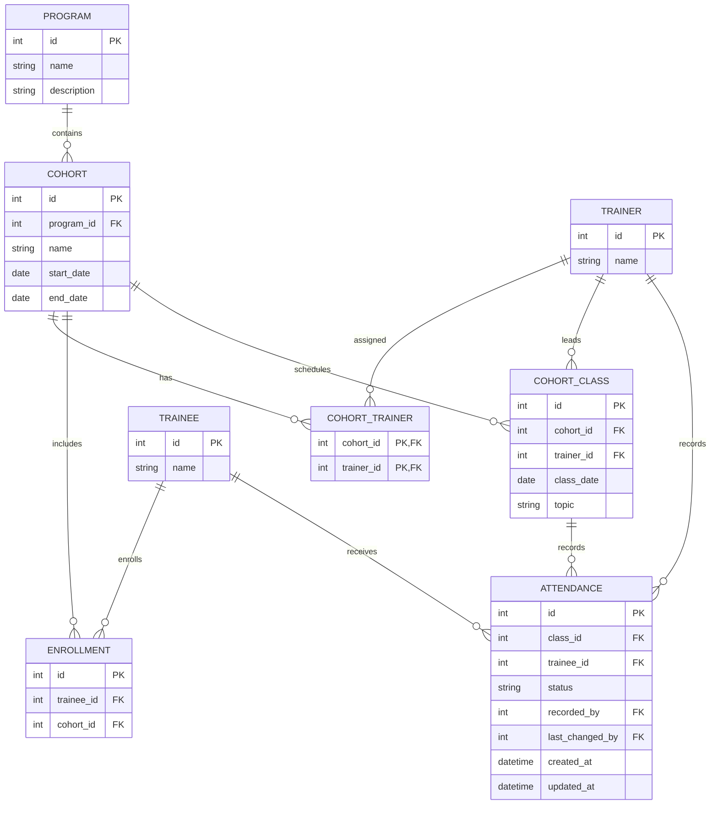

# Design - iSpark Attendance Tracker

## 1. Architecture and Domain Model

**Tech Stack:** Angular, FastAPI, PostgreSQL and psycopg 3. Frontend -  jsonAPI backend model, using angular for better ui code achitecture bootstrap presentation and fastAPI for providing request validation and automatic API documentation alongside dependency injection.

Core model definitions

- **Program -> Cohort:** A program has many cohorts; each cohort belong to one program. Program { name, description }, Cohort { name, startDate, endDate, __Program__}
- **Cohort <-> Trainer:** Many-to-many relationship, connects through __cohort_trainer__. Trainer { name, [__Cohort__] }
- **Trainee ↔ Cohort:** A many-to-many relationship through __enrollment__. A trainee is stored once and may join multiple cohorts.Trainee { name, [__Enrollment__]}, Enrollment { __Trainee__, [__Cohort__]}
- **Class <-> Trainee:** Attendance records connect trainees to classes and store their status and metadata. Class { __Cohort_, date, topic?}, Attendance { __Trainee__,__Class__,status,date}, 
AttendanceRate..To be derived

### Data model

## 2. Business-Rule Enforcement
| Rule | Enforcement |
| --- | --- |
| Cohort isolation and independent histories | Scope roster, class, history and report queries to the relevant cohort. |
| Attendance only for enrolled trainees | Backend validation before writing attendance; using transaction for batch submissions. | 
| Oly assigned trainers may lead classes or record attendance | Validate trainer membership in __cohort_trainer__ in the backend. |
| One attendance record per trainee per class | PostgreSQL `UNIQUE(class_id, trainee_id); repeated sumbmissions update the existing record. | 
| Fixed attendance status | PostgreSQL `CHECK` constraint or enum, plus backend validation. |
| Valid cohort and class dates | Backend validation and database constraints where practical. Reject attendance for future-dated classes in the backend. |
| Protect attendance history | Foreign-key restrictions and controlled update/delete operations; permit legitimate attendance corrections. |
| Recording metadata | Store the recording trainer and creation/update timestamps and the last-changing trainer. |

Using parameters for SQL queries. Running batch attendance writes in transaction to prevent partial submission

## 3. Attendance Rate

Rate is derived separately for each trainee in each cohort:

**Rate = (Present + Late) / (Present + Late + Absent) * 100**

Excluding excused classes from the denominator avoids unfair calculation. No countable classes results in rate = N/A. Trainee is flagged when calculated rate is below 75%

## 4. Assumptions

- A trainee is represented by one system-wide record and can be enrolled in multiple cohorts.
- A trainer may teach across programs and cohorts as long as they're assigned to.
- Attendance corrections have no time limit.
Attendance history is protected against accidental loss, but valid corrections remain possible.
- The attendance rate is calculated from saved attendance records rather than stored as separate entity.

## 5. Next Steps/pending

With more time, I would add a correction audit log, CSV import/export, recurring classes, cohort archiving, search and pagination, and a Docker Compose workflow. I would also expand automated tess for business rules and concurrent attendance submissions.